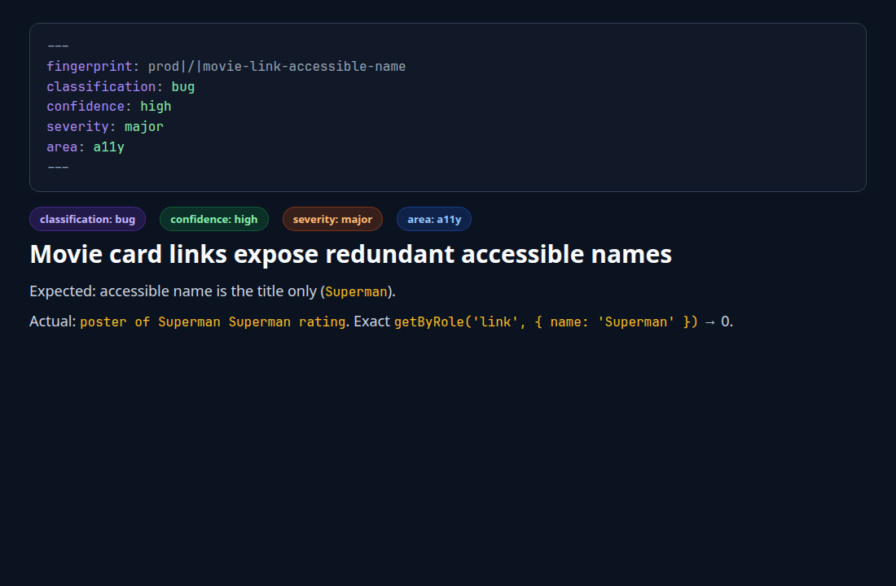

Candidate · movie-link-accessible-name.md

  

    
  

  

    frontmatter
    <code>bug · high · major · a11y</code>
  

<!--
PRESENTER NOTES: CANDIDATE (~20s)
- Frontmatter is the honesty contract for the hunt: bug, high, major, a11y.
- Exact getByRole link Superman → 0. That is the Playwright punchline.
-->
