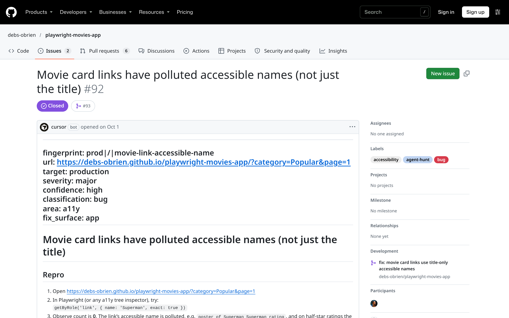

Issue #92 · filed by the agent · closed by #93

  

<!--
PRESENTER NOTES: ISSUE (~15s)
- https://github.com/debs-obrien/playwright-movies-app/issues/92
- Labels: accessibility, agent-hunt, bug. Filed by the agent on 1 Oct after the gates passed. Closed by #93 when I merged on 20 Oct.
-->
