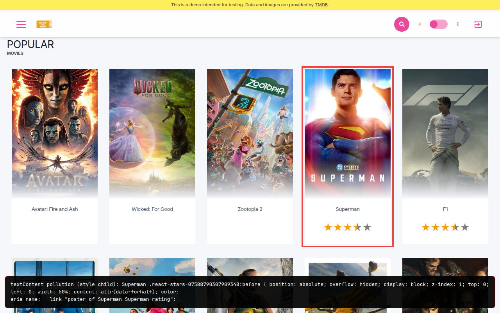

BEFORE · live · aria name pollution

  

    
  

  

    accessible name
    <code>poster of Superman Superman rating</code>
  

<!--
PRESENTER NOTES: BEFORE (~30s)
- Zoom on Superman. Read the callout out loud.
- Live production still looks like this until #93 merges.
- Mobile twin in bag if you want a quick aside.
-->
