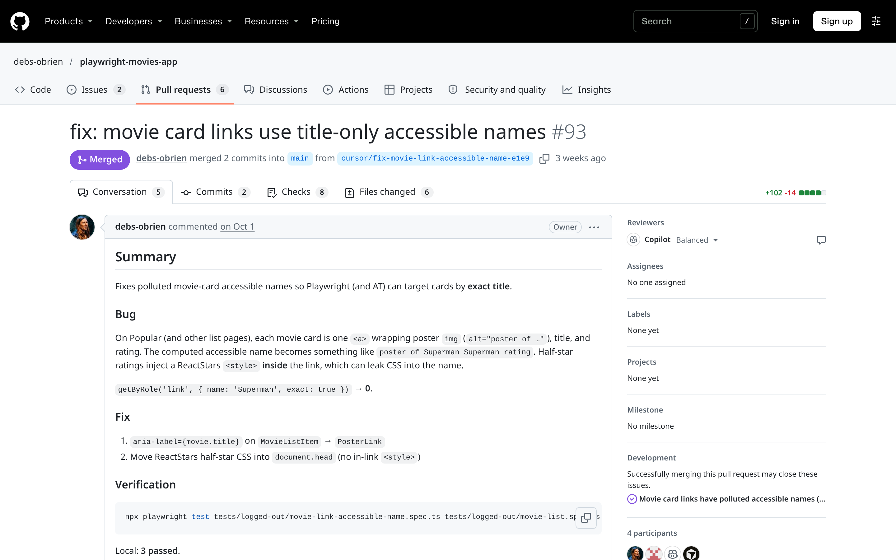

Fix PR #93 · merged · 2 commits · closes #92

  

<!--
PRESENTER NOTES: FIX PR (~20s)
- The agent opened it as a draft on purpose and stopped there. This is it now, merged.
- 2 commits, 6 files. The second commit updated two logged-in list specs after CI flagged the old link names.
- Summary: exact title locators, repro before code, regression test.
-->
