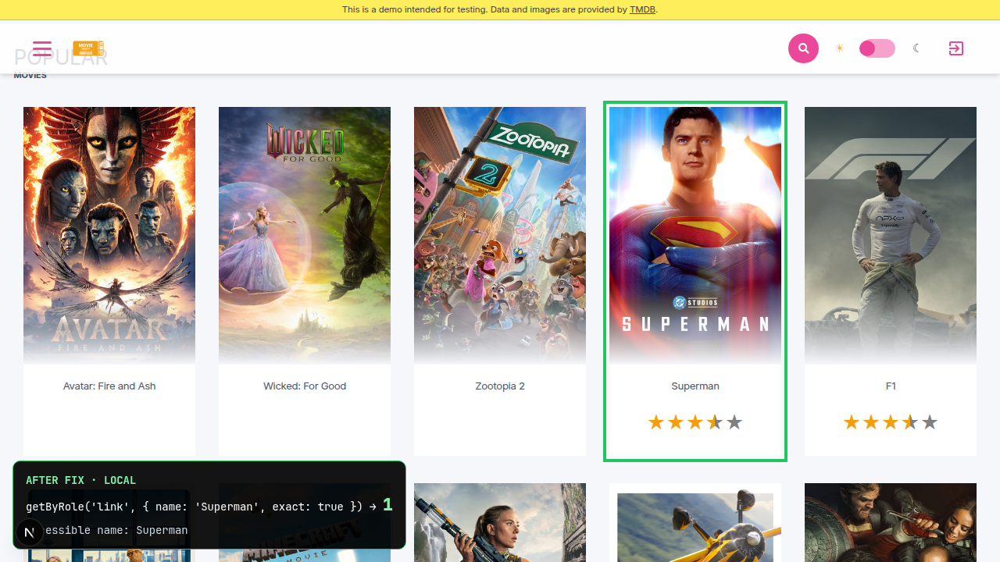

AFTER · local PR #93 · not live yet

  

    
  

  

    accessible name
    <code>Superman</code>
    exact → 1
  

<!--
PRESENTER NOTES: AFTER (~25s)
- LOCAL PR #93 worktree proof. Say that twice if needed.
- Live GH Pages is still the before until Debbie merges #93.
DEMO: show local after here if you pulled #93. Else this slide is the proof.
-->
