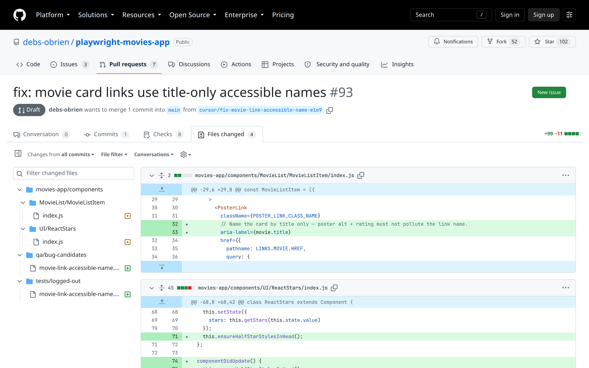

Diff · MovieListItem · one line that names the link

  

    
  

  

    the fix
    <code>aria-label=&#123;movie.title&#125;</code>
  

<!--
PRESENTER NOTES: DIFF (~25s)
- movies-app/components/MovieList/MovieListItem/index.js
- Point at aria-label={movie.title}. That is the whole punchline.
DEMO fallback: if local build fails, this slide + regression slide carry the after story.
-->
