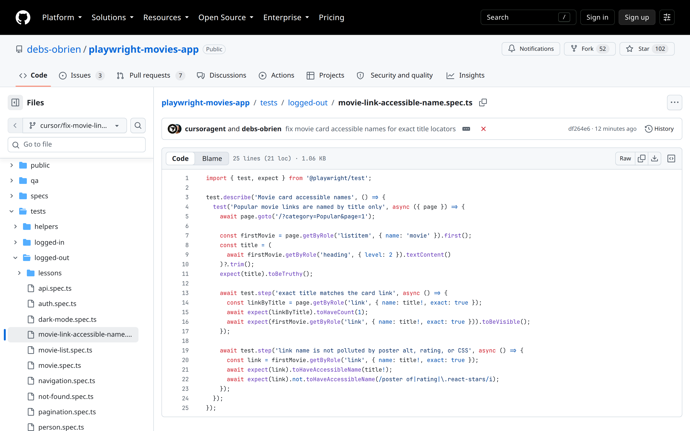

honesty 2 · regression with the fix

  

    
  

  

    green locally
    <code>1 passed (1.8s)</code>
    toHaveAccessibleName(title)
  

<!--
PRESENTER NOTES: REGRESSION (~25s)
- tests/logged-out/movie-link-accessible-name.spec.ts
- Exact title match. No poster / rating / CSS pollution.
- Green log in evidence/09-test-green.log: 1 passed.
DEMO: run it live on PR #93 if the room wifi cooperates.
-->
