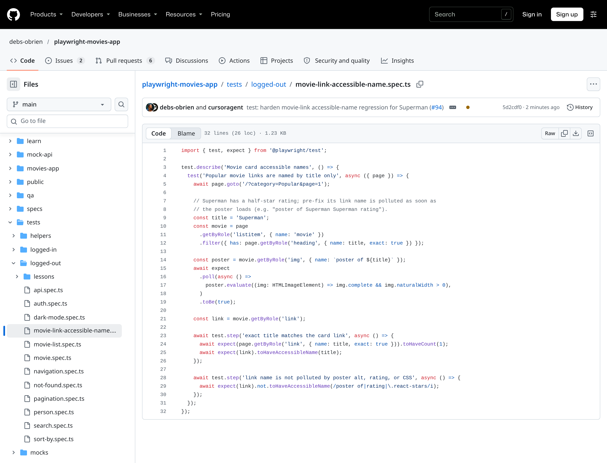

honesty 2 · regression · on main via #94

  

    
  

  

    repeat-each=5
    <code>5 passed on main</code>
    5 failed on pre-fix e628ea9
  

<!--
PRESENTER NOTES: REGRESSION (~25s)
- tests/logged-out/movie-link-accessible-name.spec.ts on main. I tightened it in #94 (merged 9 Nov).
- Targets the Superman card (half-star), waits for the poster to load, then asserts the exact title name. No poster / rating / CSS pollution.
- qa's own run, --repeat-each=5: 5 failed on pre-fix e628ea9, 5 passed on main. The #93 pair (this spec + movie-list): 3 passed. The single spec: 1 passed. All 8 CI checks green on #94.
- The #93 spec alone passed even before the fix. That is why #94 exists.
DEMO: run it on main if the wifi cooperates: npx playwright test tests/logged-out/movie-link-accessible-name.spec.ts --project=chromium
-->
