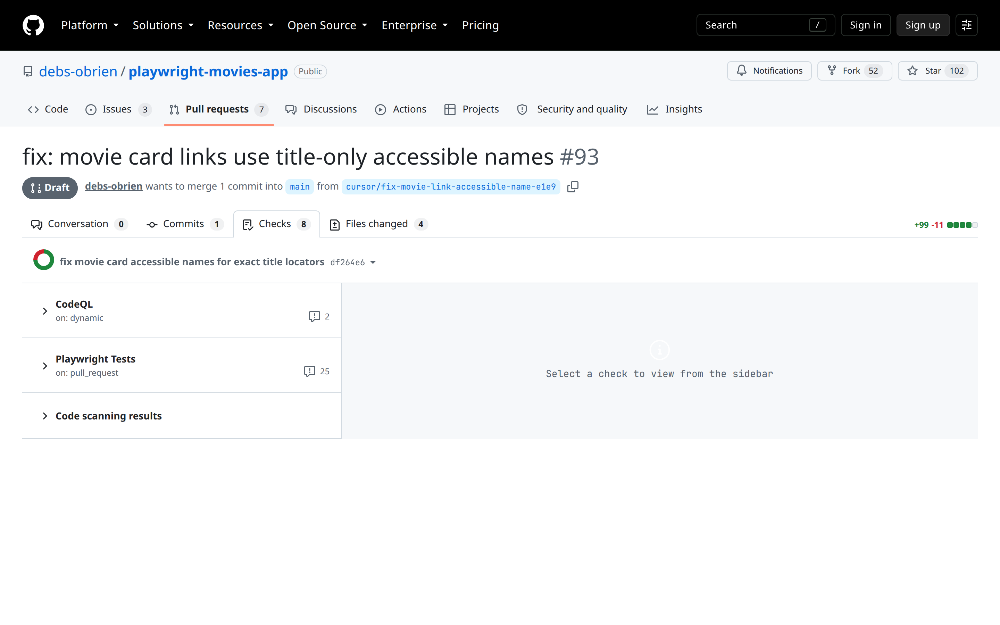

honesty 3 · Draft + Checks · you still merge

  

    
  

  

    stop rule
    <code>Agent opens. Human merges.</code>
  

<!--
PRESENTER NOTES: HUMAN MERGE (~20s)
- Draft on purpose. Agent prepared the PR. Debbie merges or does not.
- Close on the stop rule from the run sheet.
-->
