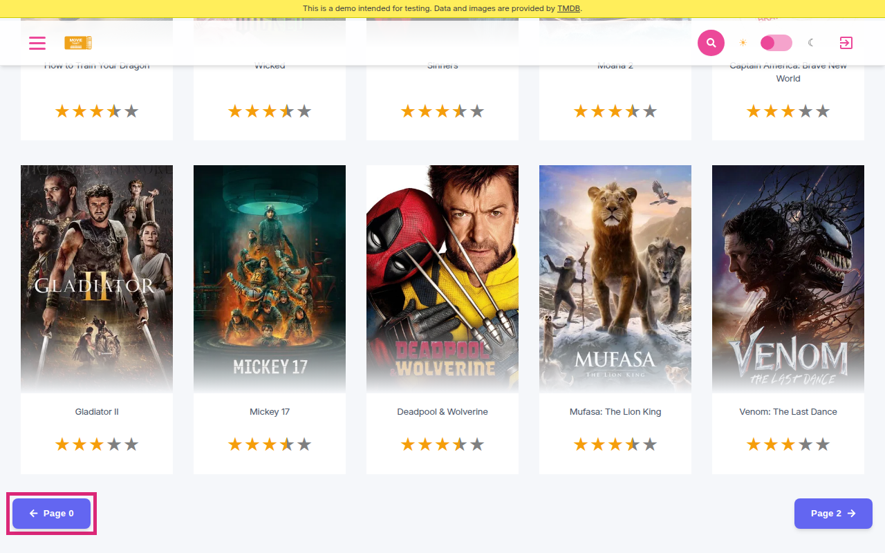
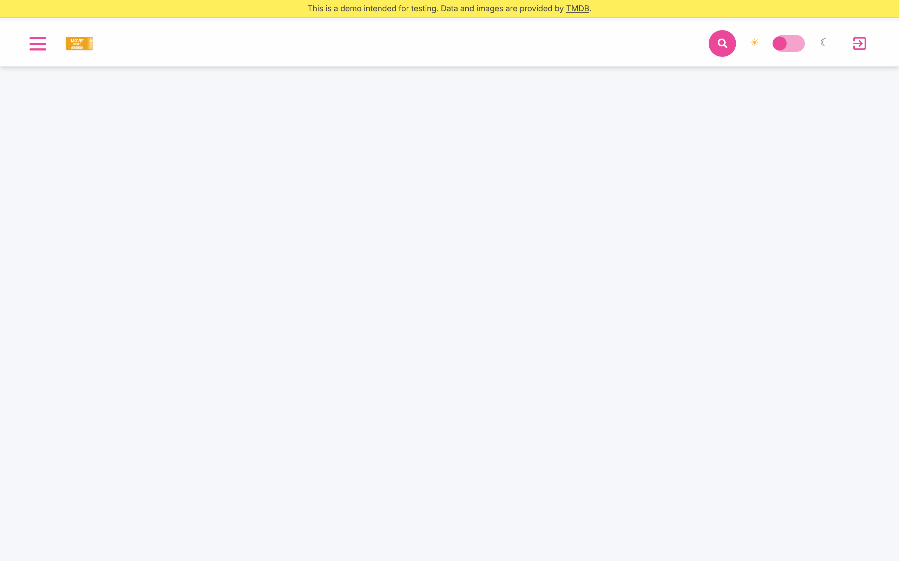

Also in the hunt · skip if tight · ?page=0

  

    

      
    

    
Page 1 has a hidden link to &ldquo;Page 0&rdquo;

  

  

    

      
    

    
After 10 s: no movies. Tab title stuck on &ldquo;Please wait a moment. Movies&rdquo;

  

<!--
PRESENTER NOTES: ALT FIND page=0 (~15s, skippable)
- Secondary only. Spine stays Superman movie-link-accessible-name.
- /?category=Popular&page=0 hangs on "Please wait a moment. Movies" with an empty page. Still broken on live (checked 9 Nov).
- Left: the hidden Page 0 link on page 1. Right: live ?page=0 after 10 seconds, no movies.
- Skip if time is tight (run sheet).
-->
