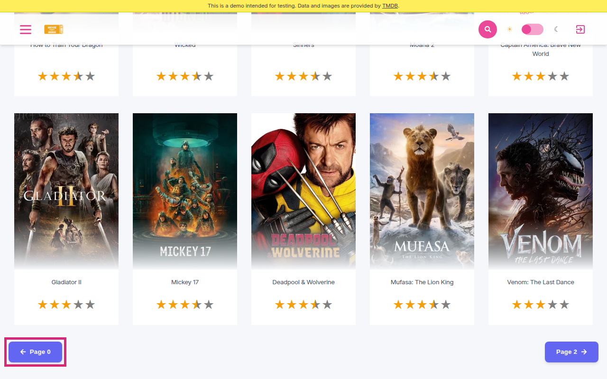

Also in the hunt · skip if tight · ?page=0

  

<!--
PRESENTER NOTES: ALT FIND page=0 (~15s, skippable)
- Secondary only. Spine stays Superman movie-link-accessible-name.
- /?category=Popular&page=0 hangs on "Please wait a moment. Movies".
- Skip if time is tight (run sheet).
-->
